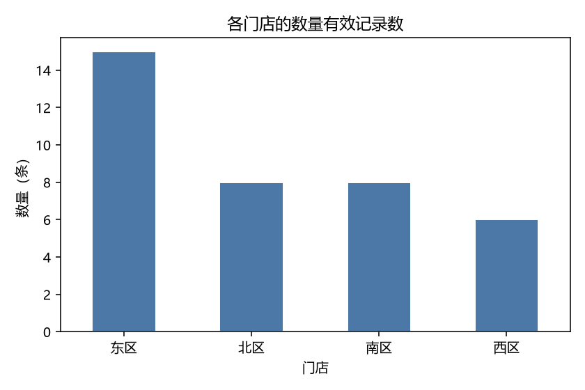
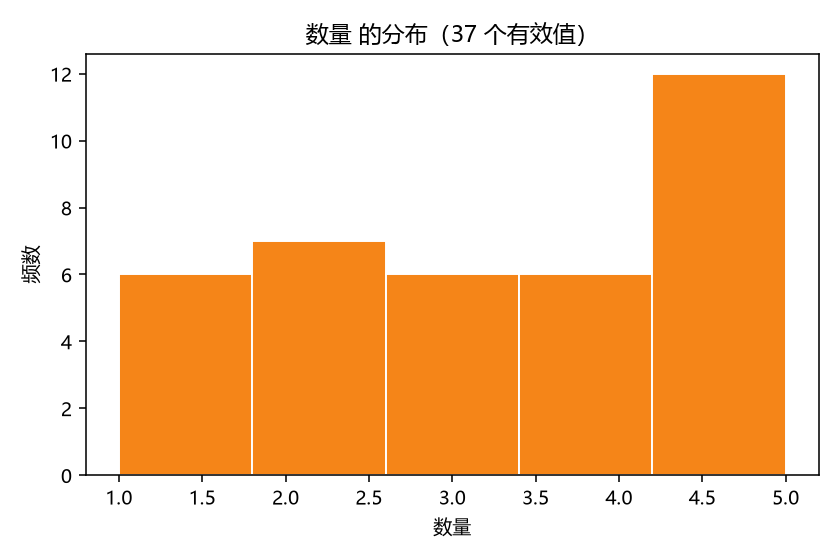

# data-toolkit

一个读 CSV、清洗（只去掉完全空白的行）、打印基础统计并出图的小工具。只依赖 pandas 和 matplotlib。

## 装什么

需要 Python 3.11 或更高。在项目根目录执行:

```powershell
python -m venv .venv
.\.venv\Scripts\Activate.ps1        # Windows PowerShell
python -m pip install -r requirements.txt
```

> 非 Windows: 把激活那行换成 `source .venv/bin/activate`。

## 一条能跑的命令

```powershell
python cli.py data/orders_big.csv --out out/
```

它会在终端打印: 形状、每列缺失数、每列 dtype、数值列均值与中位数、分组计数；
并把两张图写进 `out/`。

只想看数字不出图:

```powershell
python cli.py data/orders_big.csv --no-plot
```

## 参数

| 参数 | 作用 |
| --- | --- |
| `--out <目录>` | 图写到哪里，默认 `out/` |
| `--no-plot` | 只打印统计，不出图 |
| `--encoding <编码>` | 读 CSV 用的编码，默认 `utf-8` |
| `--by <列名>` | 指定分组列，覆盖自动猜测 |
| `--value <列名>` | 指定统计与直方图用的数值列，覆盖自动猜测 |

`--by` / `--value` 点名的列不存在时，会直接报错并列出可用列名，不会用错的列继续算:

```text
[error] 数值列不存在: 金额
可用列名: 订单号, 门店, 数量, 单价, 日期
```

文件不是 UTF-8 时（比如 Excel 另存出来的 GBK CSV）:

```powershell
python cli.py 我的表.csv --encoding gbk
```

指定了具体的列，就不用再赌启发式猜得对不对:

```powershell
python cli.py data/orders_big.csv --by 门店 --value 单价 --out out/
```

## 示例输入

`data/orders_big.csv`（49 行，故意留了缺失值和"未知"）:

```csv
订单号,门店,数量,单价,日期
A001,东区,2,9.5,2025-03-01
A002,西区,1,12.0,2025-03-01
...
```

## 示例输出





终端输出（用上面那条命令原样跑出来）:

```text
[shape] 49 行 x 5 列
[missing] 每列缺失值个数:
  订单号        0
  门店         0
  数量         12
  单价         0
  日期         0
[dtypes] 每列类型:
  订单号        str
  门店         str
  数量         float64
  单价         str
  日期         str
[numeric] 数值列统计:
  数量         有效 37/49  mean=3.2973  median=3.0000  zeros=0  negatives=0
  单价         有效 41/49  mean=11.6098  median=12.0000  zeros=0  negatives=0
[group] 按 门店 分组计数:
  东区         19
  西区         11
  北区         10
  南区         9
[plot] 已写出 out\by_group.png
[plot] 已写出 out\hist.png
```

## 已知限制

- 统计只打到终端，没有写进文件；要留档得自己重定向（`> report.txt`）。
- "哪一列是数值列"用的是比例启发式（能被 `to_numeric` 转换的值 >= 60%），
  所以一列里混了太多文字时，它会被当成分类列而不是数值列。
  拿不准时用 `--value` 直接点名。
- "哪一列是分组列"用的是"非数值 + 取值数少于行数一半"的启发式，取第一个命中的列。
  选错了用 `--by` 直接点名；`--by` 指定的列不会再过这层启发式（哪怕它取值很多或看着像数值列）。
- `--value` 指定的列如果本身就是文字列（能转成数字的值不到 60%），会报错而不是出一张空图。
- 日期列没有解析成 `datetime`，全程当字符串处理，因此做不了"按月聚合"。
- `--out` 目前只用来放图，还没有别的产物。
- `数量`/`单价` 这类"看起来是数字但有脏值"的列，转换时报废掉的值（如 `未知`）只体现在
  `有效 41/49` 里，没有单独报出"有几个值转不动"。
- `zeros`/`negatives` 是按转换后的数值列统计的；如果一列里混了日期字符串，它整列都不会进数值统计。
- `--encoding` 默认 `utf-8`，没有编码自动探测；不是 UTF-8 的文件会直接报错并提示你加
  `--encoding gbk`，编码名要写 Python 认识的（`gbk`、`gb18030`、`latin-1` 等）。
- 读文件失败（文件不存在 / 是目录 / 空文件 / 编码不对）时只打印一行 `[error]` 中文提示，
  退出码是 1，不打印堆栈。

## 目录结构

```text
cli.py                 命令行入口（清洗 -> 统计 -> 出图）
teaching/              学习脚手架，不属于工具功能
  explore.py           第一步的教学脚本（只读 + 打印）
  check_my_output.py   成绩单: python teaching/check_my_output.py --run teaching/explore.py data/orders.csv
  verify.py            独立量尺: python teaching/verify.py data/orders.csv --by 门店
data/                  示例输入
docs/images/           README 里用的成果图（提交进仓库）
out/                   生成的图（已 gitignore）
```

`teaching/` 里的脚本是我学习过程中用的自测/教学脚本，不属于工具功能。
它们假设从仓库根目录运行（`explore.py` 里的 `data/orders.csv` 是相对路径）。

## License

MIT，见 [LICENSE](LICENSE)。
